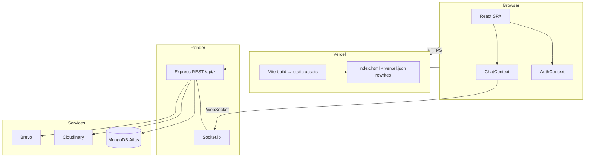

# PropHub

**PropHub** is a full-stack real estate marketplace where **buyers** browse and save listings, **sellers** manage inventory and respond to leads, and **admins** moderate users and platform activity. The app includes JWT authentication, email verification, real-time chat, image uploads, and role-based dashboards.

| | |
|---|---|
| **Live frontend** | [prop-hub-rho.vercel.app](https://prop-hub-rho.vercel.app) |
| **API** | [prophub-lyjb.onrender.com](https://prophub-lyjb.onrender.com) |


---

## Table of contents

- [Features](#features)
- [Tech stack](#tech-stack)
- [Architecture](#architecture)
- [Repository structure](#repository-structure)
- [Data model](#data-model)
- [API overview](#api-overview)
- [Authentication & authorization](#authentication--authorization)
- [Real-time chat](#real-time-chat)
- [Getting started](#getting-started)
- [Environment variables](#environment-variables)
- [Deployment](#deployment)
- [Scripts](#scripts)
- [Author](#author)

---

## Features

### Buyers
- Browse and filter properties (city, type, BHK, price, furnishing, sort)
- Property detail pages with view tracking
- Wishlist
- Send inquiries to sellers
- Real-time chat with sellers
- Profile management

### Sellers
- Seller registration with **admin approval** workflow
- Dashboard with listing and inquiry summaries
- Create / edit / delete listings with **multi-image upload** (Cloudinary)
- Mark listings as sale or sold
- View and respond to buyer inquiries
- Chat with buyers

### Admins
- Platform statistics dashboard
- User management (view, block, delete)
- Approve pending seller accounts
- Moderate all property listings
- View platform inquiries and contact form submissions

### Platform
- Email verification on registration (Brevo)
- Forgot / reset password flow
- CORS-aware REST API + Socket.io on a single backend process

---

## Tech stack

| Layer | Technologies |
|--------|----------------|
| **Frontend** | React 19, Vite 8, React Router 7, Tailwind CSS 4, Axios, Socket.io Client |
| **Backend** | Node.js, Express 5, Mongoose 9, JWT, bcrypt, Multer |
| **Database** | MongoDB (Atlas) |
| **Media** | Cloudinary |
| **Email** | Brevo (Sendinblue) API |
| **Realtime** | Socket.io |
| **Hosting** | Vercel (frontend), Render (backend) |

---

## Architecture

PropHub is a **decoupled client–server** application: the React SPA talks to an Express API over HTTPS; WebSockets reuse the same API origin for chat.



### Request flow (REST)

1. React page or context calls `axios` to `{VITE_API_URL}/api/...`.
2. Protected routes send `Authorization: Bearer <JWT>`.
3. Express applies middleware (`protect`, `authorize`) where configured.
4. **Controller** runs business logic and uses **Mongoose models**.
5. JSON response updates UI state (Context or local `useState`).

### Backend layering

```
HTTP Request
    → Route (URL + middleware chain)
    → Controller (logic, status codes)
    → Model (MongoDB)
    → Optional: Cloudinary / Brevo
```

### Frontend layering

```
main.jsx
  → BrowserRouter
    → AuthProvider (session, login, axios interceptor)
      → ChatProvider (Socket.io)
        → App.jsx (routes)
          → Pages + Layouts (Navbar, AdminLayout, SellerLayout)
          → ProtectedRoute / PublicRoute (client-side gates)
```

Client-side role checks improve UX; **the API always enforces** JWT and roles on protected endpoints.

---

## Repository structure

```
PropHub/
├── README.md                 # This file
├── frontend/                 # React + Vite SPA
│   ├── vercel.json           # SPA fallback rewrites for client-side routing
│   ├── src/
│   │   ├── main.jsx          # App bootstrap + providers
│   │   ├── App.jsx           # Route definitions
│   │   ├── config.js         # API base URL (VITE_API_URL)
│   │   ├── context/          # AuthContext, ChatContext
│   │   ├── components/       # Layouts, Navbar, PropertyCard, guards
│   │   └── pages/            # auth, shared, buyer, seller, admin
│   └── package.json
│
└── backend/                  # Express API + Socket.io
    ├── server.js             # Entry: CORS, routes, HTTP server, sockets
    ├── config/               # Database, Cloudinary
    ├── models/               # User, Property, Inquiry, Wishlist, Chat, Contact
    ├── routes/               # API route mounts
    ├── controllers/          # Request handlers
    ├── middlewares/          # JWT auth, Multer uploads
    ├── utils/                # Email, Cloudinary upload helper
    └── package.json
```

---

## Data model

| Model | Purpose | Key relations |
|--------|---------|----------------|
| **User** | Accounts with `role`: buyer, seller, admin | Seller on properties; parties in chat/inquiry |
| **Property** | Listings (price, location, type, images, status) | `seller` → User |
| **Inquiry** | Buyer message on a listing | buyer, seller, property |
| **Wishlist** | Saved properties per user | user, property |
| **Chat** | Conversation + embedded messages | participants, optional property context |
| **Contact** | Public contact form entries | Admin inbox |

User flags that drive product logic: `isVerified`, `isApproved` (sellers), `isBlocked`.

---

## API overview

Base URL: `http://localhost:5000` (local) or your deployed Render URL.

| Prefix | Description |
|--------|-------------|
| `POST/GET /api/auth/*` | Register, login, verify email, forgot/reset password, `/me` |
| `/api/user/*` | Profile read/update (including avatar) |
| `GET/POST/PUT/DELETE /api/property/*` | Public browse + seller CRUD, counts, dashboard |
| `/api/inquiry/*` | Buyer/seller inquiries |
| `/api/wishlist/*` | Wishlist CRUD |
| `/api/chat/*` | Conversations and messages (REST) |
| `POST /api/contact` | Contact form; admin list |
| `/api/admin/*` | Admin-only stats, users, sellers, properties, inquiries |

Health check: `GET /` → `API working`.

---

## Authentication & authorization

- **Registration**: password hashed with bcrypt; sellers require admin approval (`isApproved: false` until approved).
- **Email verification**: 6-digit code emailed via Brevo before login is allowed.
- **Login**: returns JWT; frontend stores token + user in `localStorage`.
- **`protect` middleware**: validates JWT and loads `req.user`; blocks if `isBlocked`.
- **`authorize(...roles)`**: restricts routes to buyer, seller, or admin.

Frontend mirrors roles with `ProtectedRoute` and nested layouts so each role lands on the correct dashboard.

---

## Real-time chat

- Socket.io runs on the **same HTTP server** as Express (`backend/server.js`).
- Client connects from `ChatContext` using the API URL as the Socket.io origin.
- Events: `joinChat` (room per chat id), `sendMessage` / `receiveMessage` for live updates.
- Message history and persistence are handled through **REST** chat routes; sockets deliver live notifications.

---

## Getting started

### Prerequisites

- Node.js 18+ (LTS recommended)
- MongoDB Atlas cluster (or local MongoDB)
- Cloudinary account
- Brevo account (for transactional email)

### 1. Clone the repository

```bash
git clone https://github.com/Khushitiwari/PropHub.git
cd PropHub
```

### 2. Backend

```bash
cd backend
npm install
```

Create `backend/.env` (see [Environment variables](#environment-variables)).

Ensure MongoDB connection is configured in `config/db.js` or via `MONGODB_URI` if you refactor the connector to use env (recommended for production).

```bash
npm start
```

API runs at **http://localhost:5000**.

### 3. Frontend

```bash
cd frontend
npm install
```

Create `frontend/.env`:

```env
VITE_API_URL=http://localhost:5000
```

```bash
npm run dev
```

App runs at **http://localhost:5173** (Vite default).

### 4. CORS

For local dev, `backend/server.js` allows `http://localhost:5173` (and 5174/5175). When you deploy a new frontend URL, add it to `allowedOrigins` and **redeploy the backend**.

---

## Environment variables

### Backend (`backend/.env`)

| Variable | Required | Description |
|----------|----------|-------------|
| `JWT_SECRET` | Yes | Secret for signing JWTs |
| `BREVO_API_KEY` | Yes | Brevo API key for email |
| `EMAIL_USER` | Yes | Verified sender email in Brevo |
| `CLOUD_NAME` | Yes | Cloudinary cloud name |
| `CLOUD_KEY` | Yes | Cloudinary API key |
| `CLOUD_SECRET` | Yes | Cloudinary API secret |
| `CLIENT_URL` | Recommended | Frontend URL for password-reset links (use in auth controller instead of hardcoded localhost) |
| `MONGODB_URI` | Recommended | MongoDB connection string (prefer env over hardcoding in `db.js`) |

Never commit `.env` files. Both `frontend/.gitignore` and `backend/.gitignore` exclude them.

### Frontend (`frontend/.env`)

| Variable | Required | Description |
|----------|----------|-------------|
| `VITE_API_URL` | Yes | Backend base URL (no trailing slash), e.g. `https://prophub-lyjb.onrender.com` |

Vite embeds `VITE_*` variables at **build time**. Set them in the Vercel project dashboard for production builds.

---

## Deployment

### Frontend (Vercel)

1. Import the GitHub repo; set **Root Directory** to `frontend`.
2. Build command: `npm run build` · Output: `dist`.
3. Add environment variable `VITE_API_URL` pointing to your Render API.
4. `frontend/vercel.json` rewrites all non-file routes to `index.html` so React Router works on **refresh and direct links** (e.g. `/login`, `/properties`).

### Backend (Render)

1. Create a **Web Service**; root directory `backend`.
2. Build: `npm install` · Start: `node server.js` (or `npm start` if you use nodemon only locally).
3. Add all backend env vars from the table above.
4. After deploying the frontend, add its URL to `allowedOrigins` in `server.js` and redeploy.

### Post-deploy checklist

- [ ] `VITE_API_URL` set on Vercel and frontend redeployed  
- [ ] Production frontend origin listed in backend CORS  
- [ ] Backend redeployed after CORS change  
- [ ] Cloudinary and Brevo credentials set on Render  
- [ ] Password reset `CLIENT_URL` matches production frontend (if using email links)

---

## Scripts

### Frontend (`frontend/`)

| Command | Description |
|---------|-------------|
| `npm run dev` | Development server |
| `npm run build` | Production build to `dist/` |
| `npm run preview` | Preview production build locally |
| `npm run lint` | ESLint |

### Backend (`backend/`)

| Command | Description |
|---------|-------------|
| `npm start` | Start API with nodemon (`server.js`) |

---

## Author

**Khooshi Tiwari**

- GitHub: [@Khushitiwari](https://github.com/Khushitiwari)

---
